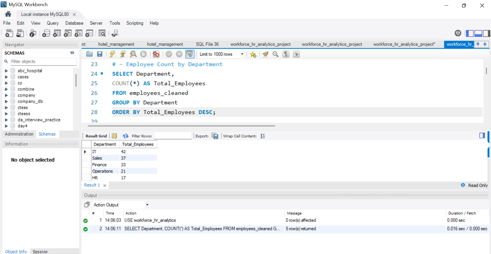
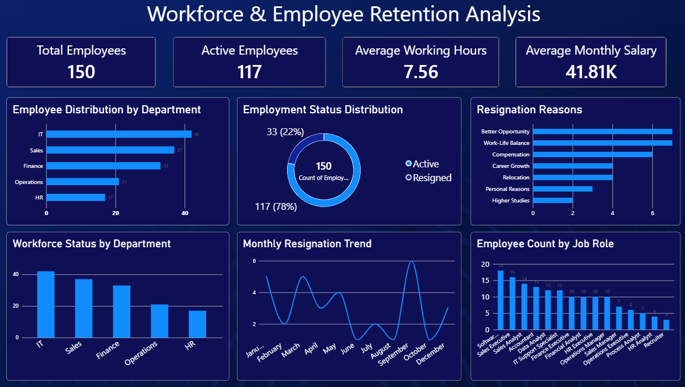
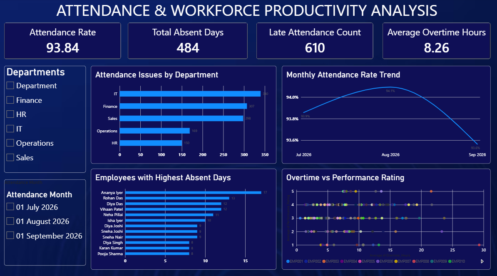

# Workforce Productivity & HR Analytics

## Project Overview

Workforce Productivity & HR Analytics is a data analytics project focused on analysing employee information, attendance, performance, and employee retention to generate meaningful insights that support HR management decisions.

The project demonstrates an end-to-end data analytics workflow using Excel, MySQL, Python, and Power BI, from data cleaning and analysis to interactive dashboard development.

## Tools & Technologies

| Tool | Purpose |
|---|---|
| Microsoft Excel | Data cleaning, validation, PivotTables, and analysis |
| MySQL | Database creation, SQL queries, joins, and business analysis |
| Python | Data cleaning, exploratory data analysis, and visualization |
| Pandas | Data manipulation and analysis |
| NumPy | Numerical operations |
| Matplotlib | Data visualization |
| Power BI | Interactive dashboards and KPI reporting |

## Dataset Description

The project uses four datasets:

1. **Employees** – Employee details, department, job role, salary, joining date, and resignation information.
2. **Departments** – Department details and department managers.
3. **Attendance** – Employee attendance records, working hours, and attendance status.
4. **Performance** – Employee performance ratings and overtime hours.

Both raw and cleaned datasets are included in this repository.

## Project Workflow

### 1. Excel – Data Cleaning & Analysis
- Checked missing values and duplicate records.
- Standardized inconsistent entries and date formats.
- Validated employee and attendance information.
- Created PivotTables, charts, and an HR dashboard.

### 2. MySQL – SQL Analysis
- Created and worked with relational tables.
- Used SELECT, WHERE, GROUP BY, ORDER BY, and aggregate functions.
- Performed JOIN operations to combine related datasets.
- Used subqueries and other SQL techniques to answer HR business questions.

### 3. Python – Exploratory Data Analysis
- Used Pandas for data cleaning and manipulation.
- Applied NumPy for numerical analysis.
- Used Matplotlib to visualize workforce patterns.
- Analysed employee distribution, salary, attendance, absenteeism, performance, and resignation patterns.

### 4. Power BI – Dashboard Development

Developed two interactive dashboards to present workforce and attendance insights.

## SQL Analysis

Selected SQL query screenshots and outputs demonstrating database analysis and business insights.




## Excel Dashboard


## Power BI Dashboards

### Dashboard 1 – Workforce & Employee Retention

Analyses employee distribution, employment status, resignation reasons, workforce structure, and employee retention.



### Dashboard 2 – Attendance & Workforce Productivity

Analyses attendance patterns, absenteeism, late attendance, overtime, and employee performance.



## Key Business Areas

- Employee distribution across departments and job roles.
- Active and resigned employee analysis.
- Resignation reasons and trends.
- Attendance and absenteeism patterns.
- Working hours and overtime analysis.
- Employee performance analysis.

## Repository Structure

```text
Workforce-Productivity-HR-Analytics/
│
├── Excel/
├── SQL/
├── Python/
├── PowerBI/
├── Dataset/
│   ├── Raw/
│   └── Cleaned/
├── Screenshots/
└── README.md
```

## Project Outcome

This project demonstrates how multiple data analytics tools can be integrated to clean, analyse, visualize, and interpret workforce data, helping HR management understand workforce patterns and support data-driven decisions.

## Dataset Disclaimer

The datasets used in this project are synthetic data created for educational and portfolio purposes. They do not contain actual company employee records.
